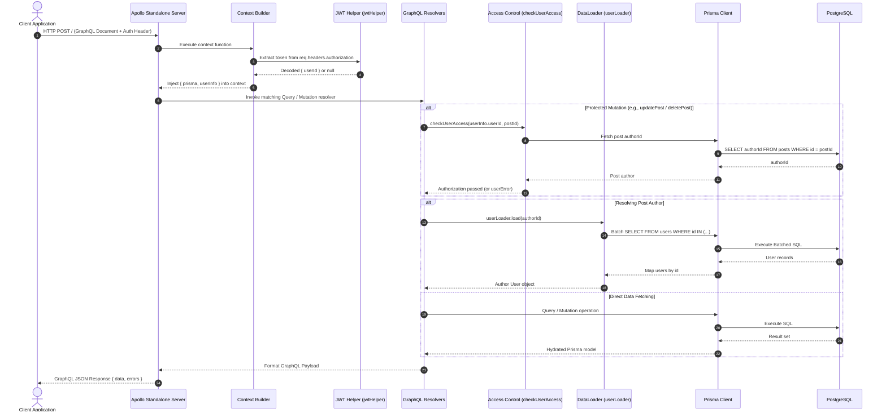
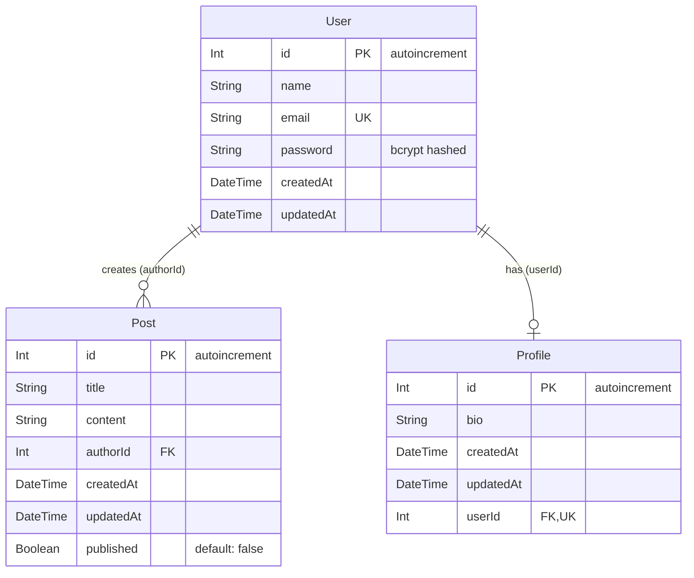

# Blog App - System Architecture & Engineering Blueprint

This document specifies the software architecture, data modeling, GraphQL component boundaries, DataLoader execution flows, and design patterns governing the **Blog App** platform.

---

## 1. High-Level System Architecture

The Blog App is structured as a decoupled full-stack architecture comprising a **React 18** client (Vite, Apollo Client, Tailwind CSS) and a **Node.js / TypeScript** GraphQL backend (Apollo Server 5, Prisma ORM, PostgreSQL).

```mermaid
graph TD
    Client["Client: React 18 / Vite (Apollo Client 3)"]
    Server["GraphQL API: Apollo Server 5 (TypeScript)"]
    DataLoader["Batching Layer: DataLoader (userLoader)"]
    Prisma["ORM: Prisma Client 5"]
    DB[("PostgreSQL Database")]

    Client -->|GraphQL Queries & Mutations (HTTP POST)| Server
    Server -->|Authorization & Context Injection| Server
    Server -->|Batched Relations| DataLoader
    DataLoader -->|Single In-Clause Query| Prisma
    Server -->|Direct Queries / Mutations| Prisma
    Prisma -->|Type-safe SQL| DB
```

---

## 2. Request & Context Lifecycle

Every GraphQL request dispatched to Apollo Server proceeds through a streamlined context pipeline:



---

## 3. DataLoader & The N+1 Solution

A central architectural pattern in this application is preventing the **N+1 query problem** when fetching posts and their respective authors.

### Without DataLoader (Naive Approach)
- 1 query to fetch $N$ posts: `SELECT * FROM posts;`
- $N$ separate queries to fetch the author for each post: `SELECT * FROM users WHERE id = post.authorId;`
- Total queries = $1 + N$ (Severe database bottleneck).

### With DataLoader (`server/src/dataLoaders/userLoader.ts`)
- Apollo Server collects all `post.author` requests in a single tick of the Node.js event loop.
- DataLoader batches all requested IDs: `SELECT * FROM users WHERE id IN (1, 2, 5, ...);`
- Results are mapped in-memory and delivered back to the respective field resolvers.
- Total queries = **2** regardless of how many posts are returned ($O(1)$ scaling).

---

## 4. Database Entity-Relationship Model (ERD)

The database schema is defined in `server/prisma/schema.prisma` and maps three primary relational entities:



---

## 5. Security & Boundary Architecture

1. **Password Hashing**: Passwords are never stored in plaintext. They are salted and hashed using `bcrypt` (10 rounds) before persistence during `signup`.
2. **Stateless JWT Session**: On successful `signIn` or `signup`, the server returns a signed JWT containing `{ userId }`. The client transmits this in the HTTP `authorization` header.
3. **Data Access Guards**: Resolvers verify `userInfo` from Apollo Context before performing privileged mutations (`addPost`, `updatePost`, `deletePost`, `publishPost`). Ownership is strictly checked against the requesting user's `userId`.
4. **Structured Error Payloads**: User-facing errors (e.g., authentication failures or permission denied) are returned gracefully inside payload types (`AuthPayload`, `PostPayload`) with a `userError` field, preventing server crashes and maintaining uniform GraphQL responses.
