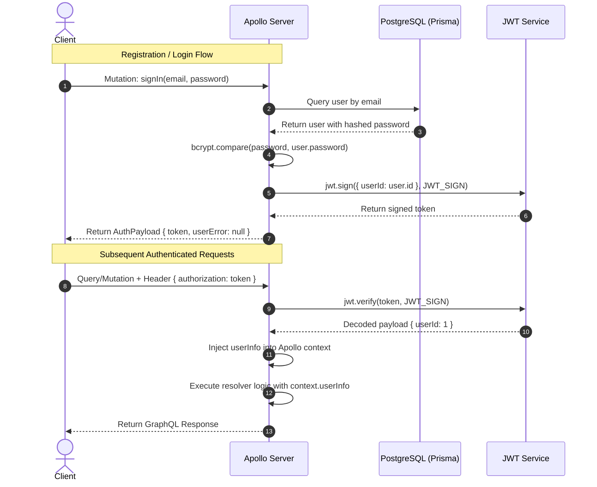

# Blog App - Authentication & Security Architecture

This document specifies the authentication lifecycle, credential hashing, context injection, and resource authorization mechanisms in the **Blog App**.

---

## 1. Security Overview

Authentication in the Blog App is based on **stateless JSON Web Tokens (JWT)** combined with **bcrypt** password hashing and **Apollo Server Context Injection**.

| Security Domain | Mechanism | Implementation |
| :--- | :--- | :--- |
| **Password Storage** | Bcrypt with salt rounds (10) | `bcrypt.hash()`, `bcrypt.compare()` |
| **Token Format** | HMAC-SHA256 JWT | `jsonwebtoken` (`sign`, `verify`) |
| **Token Transport** | HTTP Authorization Header | `authorization: <token>` |
| **Context Extraction** | Apollo Standalone Server Context | `jwtHelper.getUserInfoFromToken()` |
| **Resource Authorization** | Author Ownership Guard | `checkUserAccess(userId, postId)` |

---

## 2. Token Lifecycle



---

## 3. Apollo Context Implementation

Inside `server/src/index.ts`, Apollo Server inspects every incoming request's `authorization` header and populates `userInfo`:

```typescript
const { url } = await startStandaloneServer(server, {
  listen: { port: 4000 },
  context: async ({ req }): Promise<TContext> => {
    const userInfo = await jwtHelper.getUserInfoFromToken(
      req.headers.authorization as string
    );
    return {
      prisma,
      userInfo,
    };
  },
});
```

If the token is missing, expired, or invalid, `userInfo` defaults to `null`, allowing public queries (`posts`, `users`) while preventing unauthenticated mutations.

---

## 4. Resource Ownership Verification (`checkUserAccess`)

For post modifications (`updatePost`, `deletePost`, `publishPost`), authorization is verified at the resolver level using `checkUserAccess`:

```typescript
// server/src/utils/checkUserAccess.ts
export const checkUserAccess = async (prisma: PrismaClient, userId: number, postId: number) => {
  const user = await prisma.user.findUnique({
    where: { id: Number(userId) },
  });

  if (!user) {
    return {
      userError: "User not found!",
      post: null,
    };
  }

  const post = await prisma.post.findUnique({
    where: { id: Number(postId) },
  });

  if (!post) {
    return {
      userError: "Post not found!",
      post: null,
    };
  }

  if (post.authorId !== user.id) {
    return {
      userError: "Post not owned by user!",
      post: null,
    };
  }

  return null;
};
```

This prevents **Insecure Direct Object Reference (IDOR)** attacks where an authenticated user attempts to modify or delete another user's post.
