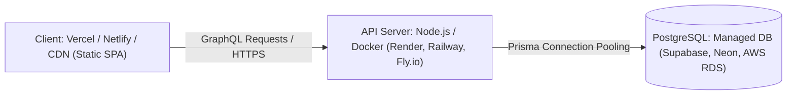

# Blog App - Production Deployment Guide

This document describes the deployment architecture, environment configurations, containerization, and hosting strategies for the **Blog App** monorepo.

---

## 1. Production Architecture Overview

In production, the application is deployed as two decoupled components plus a managed relational database:



---

## 2. Server Deployment (`server/`)

### 2.1 Build Step
Compile TypeScript into production JavaScript:
```bash
cd server
npm install --omit=dev
npx prisma generate
npm run build
```

### 2.2 Dockerfile for Server
Create a production `server/Dockerfile`:
```dockerfile
# Stage 1: Build
FROM node:20-alpine AS builder
WORKDIR /app
COPY package*.json tsconfig.json ./
COPY prisma ./prisma/
RUN npm ci
COPY src ./src/
RUN npx prisma generate
RUN npm run build

# Stage 2: Production Runtime
FROM node:20-alpine AS runner
WORKDIR /app
ENV NODE_ENV=production
COPY package*.json ./
RUN npm ci --omit=dev
COPY prisma ./prisma/
RUN npx prisma generate
COPY --from=builder /app/dist ./dist

EXPOSE 4000
CMD ["node", "dist/index.js"]
```

### 2.3 Required Production Environment Variables
- `DATABASE_URL`: Full PostgreSQL connection URI with SSL enabled (e.g., `?sslmode=require`).
- `JWT_SIGN`: Strong, cryptographically random secret string.
- `PORT`: Server listening port (default `4000` or assigned by host).

---

## 3. Client Deployment (`client/`)

### 3.1 Build Command
```bash
cd client
npm install
npm run build
```
This produces an optimized, static distribution in `client/dist/`.

### 3.2 Single Page Application (SPA) Routing Configuration
Since React Router handles routing on the client side, configure rewrites so all routes serve `index.html`.

#### For Vercel (`client/vercel.json`):
```json
{
  "rewrites": [
    {
      "source": "/(.*)",
      "destination": "/index.html"
    }
  ]
}
```

#### For Netlify (`client/public/_redirects`):
```
/*    /index.html   200
```

---

## 4. Post-Deployment Checklist

- [ ] Execute `npx prisma migrate deploy` on production database before launching the new server container.
- [ ] Verify CORS configuration on Apollo Server to allow only the production client domain.
- [ ] Ensure `JWT_SIGN` is set to a secure 256-bit key.
- [ ] Test GraphQL queries (`posts`) and mutations (`signIn`, `addPost`) over HTTPS.
